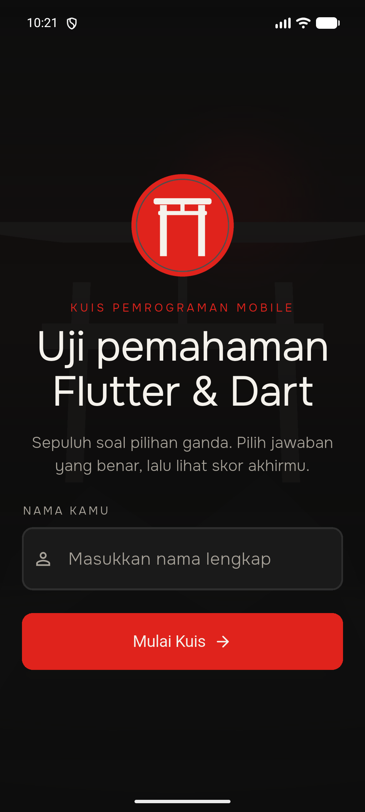
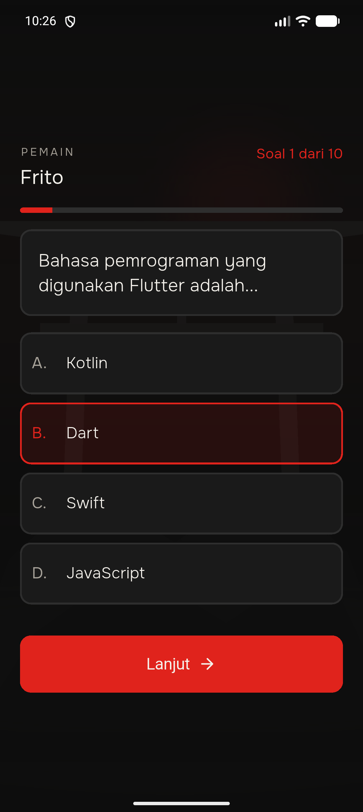
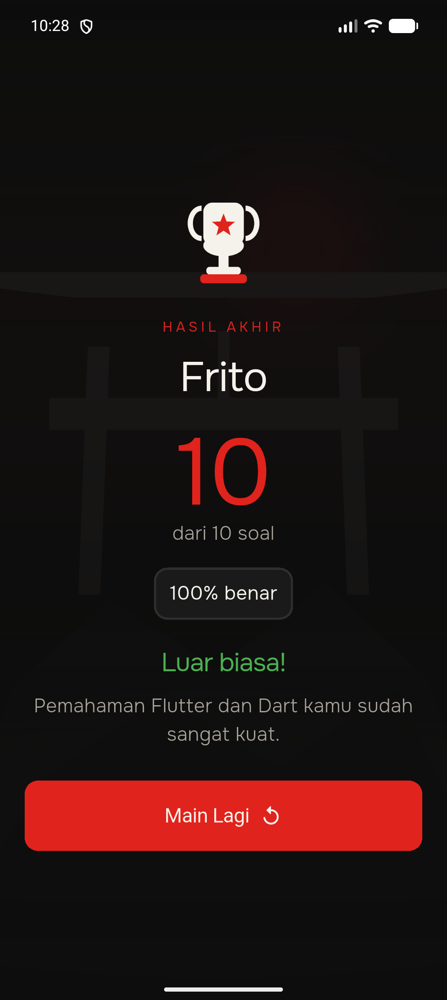

# Kuis Pemrograman Mobile

Aplikasi kuis pilihan ganda berbasis Flutter untuk UTS Lab Pemrograman Mobile.
Pengguna memasukkan nama, menjawab 10 soal dasar Flutter & Dart, lalu melihat
skor akhir. Tampilan memakai tema gelap dengan aksen merah vermilion dan font
Onest.

## Fitur

- Input nama dengan validasi (tidak boleh kosong).
- 10 soal pilihan ganda dummy (A–D) tanpa database/API.
- Jawaban terpilih ditandai, tombol **Lanjut** aktif setelah memilih.
- Indikator "Soal x dari 10" dan progress bar beranimasi.
- Skor akhir berupa jumlah benar, persentase, dan pesan sesuai nilai.
- Tombol **Main Lagi** mereset seluruh progres.
- State kuis disimpan di `QuizProvider` pada root aplikasi, sehingga aman saat
  rotasi layar atau pindah halaman.
- Layout responsif untuk portrait dan landscape, dengan scroll bila konten
  melebihi layar.
- Transisi fade antar-halaman dan animasi pergantian soal.

## Teknologi

- Flutter 3.47 / Dart 3.13
- [`provider`](https://pub.dev/packages/provider) untuk state management
- Font Onest (dibundel lokal, tanpa `google_fonts`)

## Struktur Singkat

```
lib/
├── main.dart                 # root aplikasi + ChangeNotifierProvider
├── data/questions_data.dart  # 10 soal dummy
├── models/question.dart      # model soal
├── pages/                    # WelcomePage, QuizPage, ResultPage
├── providers/quiz_provider.dart
├── theme/app_theme.dart      # warna dan tema
├── utils/                    # responsive helper + route fade
└── widgets/                  # widget reusable
```

## Menjalankan

Pastikan Flutter sudah terpasang, lalu:

```bash
flutter pub get
flutter run
```

Untuk memilih perangkat tertentu:

```bash
flutter devices
flutter run -d <device-id>
```

## Pengujian

```bash
flutter analyze
flutter test
```

## Screenshot

| Halaman Nama | Halaman Kuis | Halaman Hasil |
|---|---|---|
|  |  |  |

## Catatan

- Data soal ada di `lib/data/questions_data.dart` sesuai `docs/QUESTIONS.md`.
- Panduan visual ada di `DESIGN.md`. Beberapa warna dan spacing ditandai
  *(asumsi)* karena screenshot referensi belum tersedia; nilainya perlu
  diverifikasi pemilik project.
- Kredit font dan aset ada di [docs/CREDITS.md](docs/CREDITS.md).
