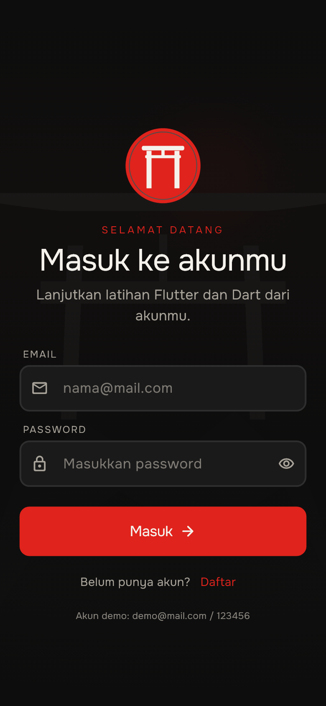
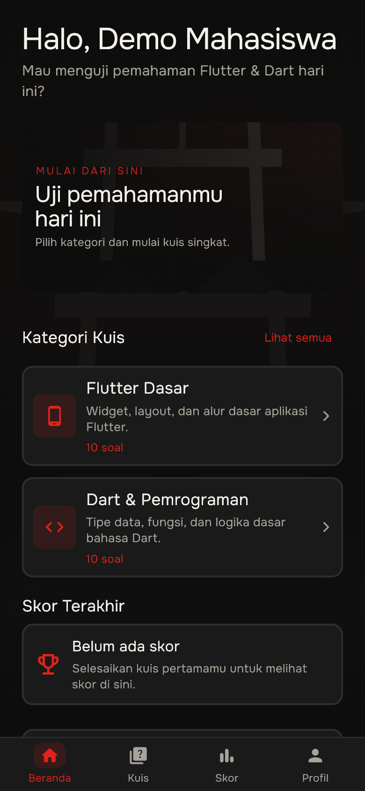
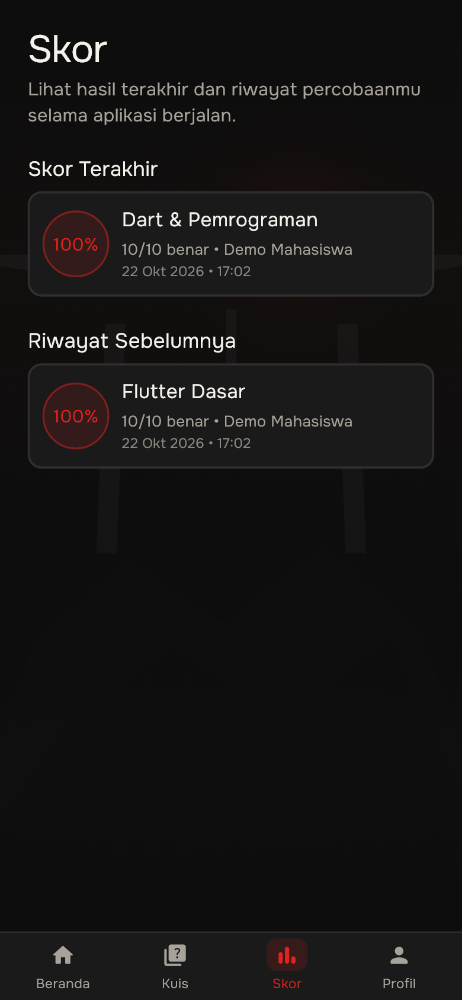
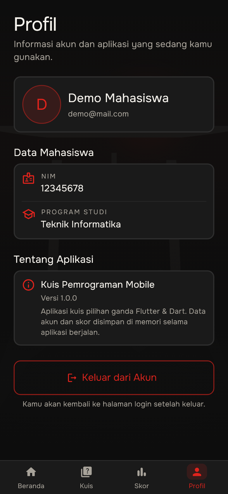

# Kuis Pemrograman Mobile

Aplikasi kuis pilihan ganda berbasis Flutter untuk UTS Lab Pemrograman Mobile.
Pengguna membuat akun atau login, memilih kategori, menjawab 10 soal, lalu
melihat skor dan riwayat percobaan. Tampilan memakai tema gelap dengan aksen
merah vermilion dan font Onest.

## Fitur

- Login dengan email dan password, lengkap dengan validasi, pesan error, dan
  tombol tampilkan/sembunyikan password.
- Registrasi akun dengan nama, NIM, email, program studi, password, dan
  konfirmasi password.
- Akun dummy dan akun hasil registrasi disimpan di memori selama aplikasi
  berjalan, tanpa database atau API.
- `MainShell` dengan 4 tab yang state-nya tetap hidup melalui `IndexedStack`:
  Beranda, Kuis, Skor, dan Profil.
- Dua kategori kuis, masing-masing berisi 10 soal pilihan ganda (A–D).
- Kuis dibuka sebagai layar penuh tanpa bottom navigation. Jawaban terpilih
  ditandai dan tombol **Lanjut** aktif setelah memilih.
- Indikator "Soal x dari 10", progress bar, dan animasi pergantian soal.
- Halaman hasil berisi jumlah benar, persentase, dan pesan sesuai skor.
- Riwayat skor tersimpan di `QuizProvider` selama aplikasi berjalan.
- Profil menampilkan data akun dan info aplikasi, serta tombol logout.
- State sesi dan kuis berada di Provider pada root aplikasi, sehingga aman saat
  rotasi atau pindah halaman.
- Layout responsif untuk portrait, landscape, layar kecil, dan tablet.
- Transisi fade antar-halaman.

## Alur Aplikasi

```text
Splash
  └── Login <──> Register
        └── MainShell (Beranda | Kuis | Skor | Profil)
              └── QuizPage (layar penuh)
                    └── ResultPage
                          └── Main Lagi -> QuizPage
```

- Login atau registrasi berhasil membuka `MainShell` dan membersihkan halaman
  auth dari tumpukan navigasi.
- Tombol back dari hasil tidak membuka kembali kuis yang sudah selesai.
- Logout menghapus sesi dan kembali ke Login dengan tumpukan navigasi yang
  bersih.

## Akun Demo

| Email | Password | Nama |
|---|---|---|
| `demo@mail.com` | `123456` | Demo Mahasiswa |
| `budi@mail.com` | `123456` | Budi Santoso |

Akun hasil registrasi juga dapat dipakai sampai aplikasi ditutup.

## Teknologi

- Flutter 3.47 / Dart 3.13
- [`provider`](https://pub.dev/packages/provider) untuk state management
- Font Onest (dibundel lokal, tanpa `google_fonts`)

## Struktur Singkat

```text
lib/
├── main.dart                 # root aplikasi + MultiProvider
├── data/
│   ├── dummy_users.dart      # akun demo
│   └── questions_data.dart   # 2 kategori × 10 soal
├── models/                   # User, Category, Question, ScoreRecord
├── pages/                    # Splash, Login, Register, MainShell, Beranda,
│                             # Kuis, Quiz, Result, Skor, Profil
├── providers/                # AuthProvider dan QuizProvider
├── theme/app_theme.dart      # warna dan tema
├── utils/                    # responsive helper + route fade
└── widgets/                  # widget reusable
```

## Menjalankan

Pastikan Flutter sudah terpasang, lalu:

```bash
flutter pub get
flutter run
```

Untuk memilih perangkat tertentu:

```bash
flutter devices
flutter run -d <device-id>
```

## Pengujian

```bash
flutter analyze
flutter test
```

Pengujian mencakup validasi auth, alur login/register, navigasi, penyimpanan
skor, logout, serta layout pada ukuran layar kecil, portrait, landscape, dan
tablet.

## Screenshot

| Login | Beranda | Kuis |
|---|---|---|
|  |  |  |

| Hasil | Skor | Profil |
|---|---|---|
|  |  |  |

## Catatan

- Data soal ada di `lib/data/questions_data.dart` sesuai `docs/QUESTIONS.md`.
- Semua data akun dan skor hanya tersimpan selama aplikasi berjalan. Tidak ada
  database, API, atau penyimpanan permanen.
- Panduan visual ada di `DESIGN.md`. Beberapa warna dan spacing ditandai
  *(asumsi)* karena screenshot referensi belum tersedia; nilainya perlu
  diverifikasi pemilik project.
- Kredit font dan aset ada di [docs/CREDITS.md](docs/CREDITS.md).
