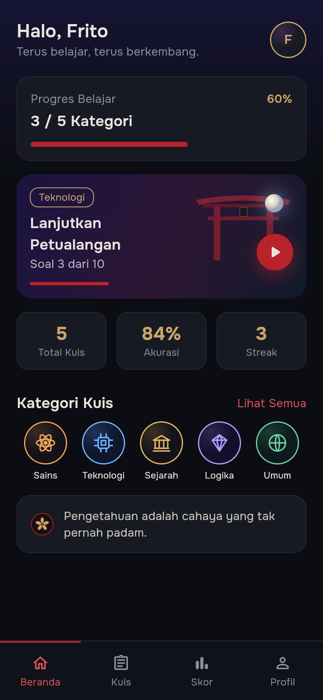
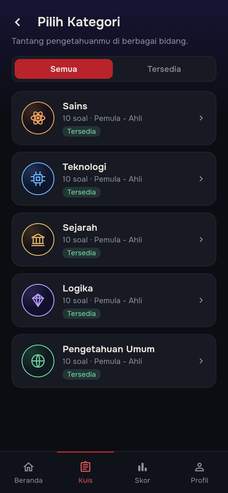
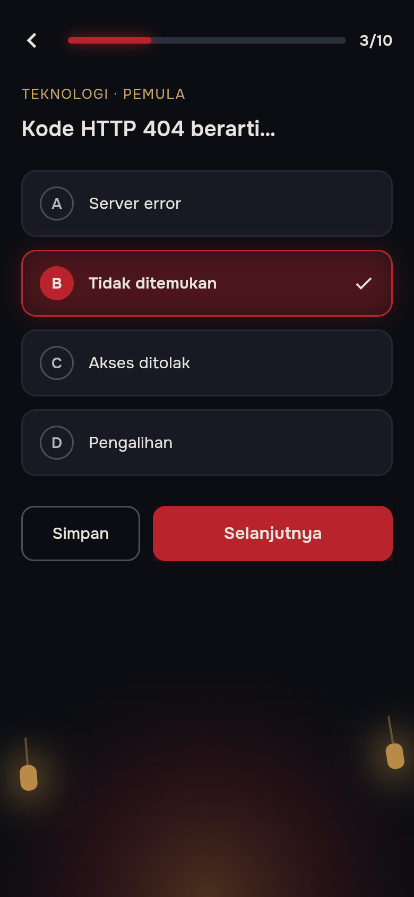
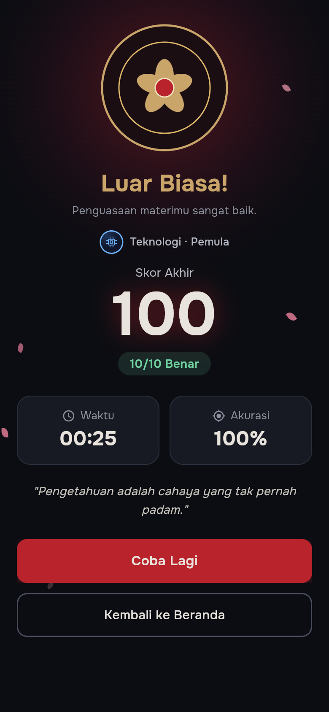
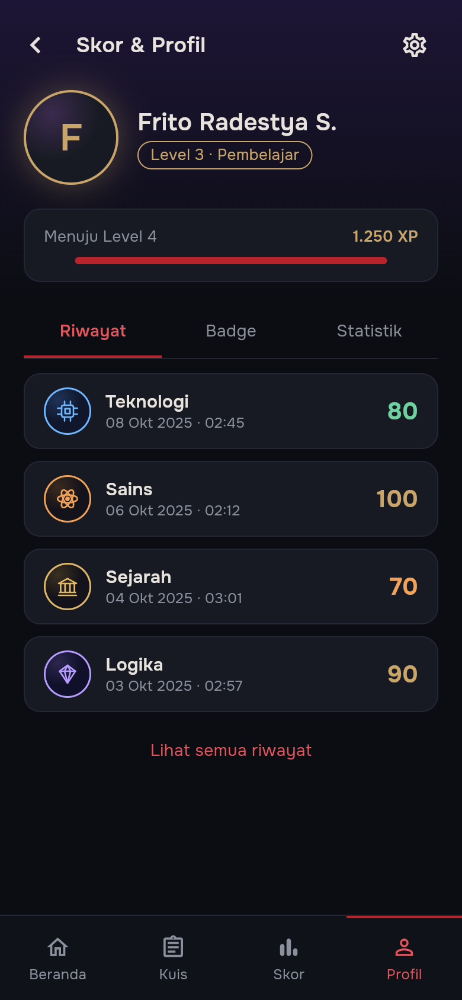

<div align="center">


# KAGE

### The Quiz Sanctuary

Aplikasi kuis pilihan ganda bertema kuil Jepang malam hari, dibangun dengan Flutter
untuk UTS Lab Pemrograman Mobile.

[](https://flutter.dev)
[](https://dart.dev)
[](#menjalankan-aplikasi)
[](https://github.com/Frito-Radestya/UTS_LAB_Pemrograman-Mobile-5/actions/workflows/ci.yml)

</div>

---

## Tentang Proyek

**KAGE — The Quiz Sanctuary** adalah aplikasi kuis yang mengajak pengguna belajar
melalui perjalanan visual bernuansa kuil Jepang: gerbang torii, lentera, bulan,
kelopak sakura, dan langit malam. Aplikasi memiliki alur lengkap mulai dari
splash screen, login/registrasi, pemilihan kategori, pengerjaan kuis, pembahasan
jawaban, hingga hasil dan riwayat skor.

Tidak ada backend: seluruh data disimpan **secara lokal di perangkat** memakai
`shared_preferences` (sesi login dan pengaturan) serta Hive (riwayat kuis, XP, dan
kuis yang sedang berjalan). Menutup aplikasi tidak menghilangkan progres belajar.
Cocok digunakan sebagai proyek pembelajaran Flutter dan demonstrasi UI/UX.

## Fitur Utama

- **Splash screen sinematik** dengan animasi lentera, kelopak sakura, dan progress bar.
- **Login & registrasi** dengan validasi form, pesan error, dan toggle password.
- **Beranda personal** berisi sapaan, progres belajar, kartu lanjutkan petualangan,
  statistik, kategori, dan kutipan.
- **5 kategori kuis**: Sains, Teknologi, Sejarah, Logika, dan Pengetahuan Umum.
- **70 soal pilihan ganda** dengan pembahasan dan fakta menarik. Sains sudah
  lengkap untuk tiga tingkat (10 soal per tingkat); kategori lain masih bertahap
  dan menandai tingkat yang belum tersedia sebagai "Segera hadir".
- **Pemilihan tingkat kesulitan**: Pemula, Menengah, dan Ahli dengan pengali XP
  berbeda serta jumlah soal aktual per tingkat.
- **Penyimpanan progres kuis** ke Beranda, termasuk konfirmasi saat keluar di tengah kuis.
- **Data tersimpan permanen** di perangkat: sesi login, riwayat, XP, kuis tersimpan,
  dan pengaturan tetap ada setelah aplikasi ditutup.
- **Halaman hasil** dengan animasi skor, jumlah benar, akurasi, dan durasi.
- **Riwayat skor** dengan filter kategori dan ringkasan statistik.
- **Badge & pencapaian** yang dihitung dari riwayat kuis.
- **Profil pengguna** dengan level, XP, edit nama/email, dan pengaturan.
- **Bottom navigation** untuk Beranda, Kuis, Skor, dan Profil.
- **Transisi halaman halus** (fade + slide) di seluruh aplikasi.
- **Responsif** untuk ponsel, tablet, dan web; konten dibatasi 520 px di layar lebar.
- **Dukungan Flutter Web** dengan metadata, manifest, dan ikon KAGE.

## Tampilan Aplikasi

<div align="center">









</div>

Tangkapan layar diambil dari build web pada viewport ponsel 390 × 844.

## Alur Aplikasi

```text
Splash
  └── Login ──> Register
        └── Beranda ──> Kategori ──> Detail Kategori
              │                          └── Kuis ──> Penjelasan
              │                                        └── Hasil
              ├── Riwayat (filter & statistik)
              ├── Profil ──> Badge
              │          └── Pengaturan
              └── Lanjutkan Petualangan ──> Kuis
```

## Teknologi

| Kebutuhan | Implementasi |
|---|---|
| Framework | Flutter 3.47 / Dart 3.13 |
| Navigasi | [`go_router`](https://pub.dev/packages/go_router) 18.x |
| State management | [`provider`](https://pub.dev/packages/provider) 6.x (`ChangeNotifier`) |
| Aset vektor | [`flutter_svg`](https://pub.dev/packages/flutter_svg) 2.x |
| Penyimpanan ringan | [`shared_preferences`](https://pub.dev/packages/shared_preferences) 2.5 (sesi & pengaturan) |
| Basis data lokal | [`hive`](https://pub.dev/packages/hive) 2.2 + `hive_flutter` 1.1 (riwayat, XP, resume) |
| Tipografi | Font lokal **Onest** & **Cinzel** (`assets/fonts/`) |
| Ikon | Material Icons + aset SVG khusus KAGE |

### Palet Warna

| Token | Warna | Penggunaan |
|---|---|---|
| Primary / Vermilion | `#B9232C` | Tombol utama, jawaban terpilih, progress bar |
| Background / Midnight | `#0B0D12` | Latar utama |
| Surface / Charcoal | `#171A22` | Kartu, input, panel |
| Gold / Antique Gold | `#C9A56A` | Aksen, badge, ornamen, level |
| Text / Ivory | `#E8E4DD` | Teks utama |
| Muted | `#8B909C` | Teks sekunder dan metadata |

Warna aksen kategori: Sains `#F0A25A`, Teknologi `#6EB6FF`, Sejarah `#E0B86A`,
Logika `#B79CFF`, dan Umum `#6FD0A0`.

## Struktur Proyek

```text
lib/
├── main.dart                       # Entry point
├── app.dart                        # MaterialApp.router, GoRouter, responsive frame
├── app_services.dart               # Komposisi controller + penghubung hasil kuis
├── data/
│   ├── quiz_data.dart              # Bank soal per kategori & tingkat
│   ├── local/
│   │   ├── local_box.dart          # Pembuka kotak Hive (riwayat, XP, resume)
│   │   └── quiz_codec.dart         # Encode/decode JSON model kuis
│   └── repositories/
│       ├── quiz_repository.dart     # Kontrak bank soal + implementasi lokal
│       ├── auth_repository.dart     # Kontrak sesi + in-memory + shared_preferences
│       ├── history_repository.dart  # Kontrak riwayat + in-memory + Hive
│       ├── progress_repository.dart # Kontrak XP & resume + in-memory + Hive
│       └── settings_repository.dart # Kontrak preferensi + shared_preferences
├── models/
│   └── models.dart                 # CategoryId, Difficulty, Question, QuizResult, BadgeItem
├── features/
│   ├── auth/
│   │   ├── auth_controller.dart    # Sesi, identitas, dan profil pengguna
│   │   ├── login_page.dart
│   │   └── register_page.dart
│   ├── quiz/
│   │   ├── quiz_controller.dart    # Sesi kuis, jawaban, penguncian, resume
│   │   ├── kategori_page.dart
│   │   ├── detail_kategori_page.dart
│   │   ├── kuis_page.dart
│   │   ├── penjelasan_page.dart
│   │   └── hasil_page.dart
│   ├── history/
│   │   ├── history_controller.dart # Riwayat, statistik, dan badge
│   │   ├── streak.dart             # Perhitungan streak harian
│   │   ├── riwayat_page.dart
│   │   └── badge_page.dart
│   ├── home/
│   │   └── beranda_page.dart
│   ├── profile/
│   │   ├── progress_controller.dart # XP dan level
│   │   ├── progress.dart           # Kurva XP murni
│   │   └── profil_page.dart
│   ├── settings/
│   │   ├── settings_controller.dart # Preferensi aplikasi
│   │   └── pengaturan_page.dart
│   └── splash/
│       └── splash_page.dart
├── theme/
│   ├── app_colors.dart             # Token warna
│   └── app_theme.dart              # Onest, Cinzel, ThemeData
└── widgets/
    ├── kage_widgets.dart           # Barrel export untuk seluruh widget reusable
    ├── kage_wordmark.dart
    ├── sakura_petal.dart
    ├── moon_glow.dart
    ├── lantern.dart
    ├── star_field.dart
    ├── clippers.dart
    ├── torii_art.dart
    ├── emblem_mark.dart
    ├── category_icon_badge.dart
    ├── primary_button.dart
    ├── outline_button.dart
    ├── app_text_field.dart
    ├── kage_progress_bar.dart
    ├── back_icon_button.dart
    ├── score_row.dart
    ├── kage_bottom_nav.dart
    ├── top_wash.dart
    └── screen_scaffold.dart
```

Aset visual berada di `assets/svg/` dan font di `assets/fonts/`. Paket desain asli
(spesifikasi dan sumber HTML) disimpan di `kage_package/` sebagai referensi.
Tangkapan layar untuk dokumentasi berada di `docs/screenshots/`.

State dipisahkan per tanggung jawab. `AuthController`, `QuizController`,
`HistoryController`, `ProgressController`, dan `SettingsController` masing-masing
memiliki `ChangeNotifier` sendiri. `AppServices` hanya menjadi titik komposisi:
ia menghubungkan hasil kuis ke riwayat dan XP tanpa membuat controller saling
mengenal. Halaman mengambil controller yang dibutuhkan lewat `provider`.

Folder `lib/features/` mengelompokkan controller dan halaman berdasarkan domain
(auth, quiz, history, home, profile, settings, splash). Kode yang dipakai lintas
fitur tetap berada di `models/`, `data/`, `theme/`, dan `widgets/`. Seluruh import
internal memakai `package:kage/...` agar pemindahan file tidak memutus jalur
relatif.

Setiap widget reusable memiliki file sendiri di `lib/widgets/`. Berkas
`kage_widgets.dart` dipertahankan sebagai barrel export agar halaman cukup
mengimpor satu jalur tanpa bergantung pada lokasi internal setiap komponen.

Akses data melewati repository. `QuizRepository` membungkus bank soal,
`AuthRepository` menyimpan identitas sesi, `HistoryRepository` menangani
penyimpanan riwayat, `ProgressRepository` menyimpan XP dan kuis tersimpan, serta
`SettingsRepository` menyimpan preferensi. Controller hanya bergantung pada
kontrak tersebut, sehingga sumber soal, autentikasi, atau media penyimpanan
dapat diganti tanpa mengubah logika fitur.

`AppServices.create()` menyiapkan penyimpanan permanen lalu memakai implementasi
lokal: `LocalAuthRepository` dan `LocalSettingsRepository` di atas
`shared_preferences`, serta `LocalHistoryRepository` dan
`LocalProgressRepository` di atas kotak Hive. Implementasi in-memory tetap tersedia
untuk pengujian dan menjadi nilai bawaan `AppServices()`.

Tipografi memakai gaya bernama di `AppTextStyles` (`displayLarge`, `titleLarge`,
`body`, `caption`, `label`, dan variannya). Halaman tidak lagi menulis ukuran,
tinggi baris, atau warna teks secara berulang; nilai dinamis seperti warna status
cukup diturunkan dengan `copyWith`.

## Rute Aplikasi

| Rute | Halaman |
|---|---|
| `/` | Splash |
| `/login` | Login |
| `/register` | Registrasi |
| `/beranda` | Beranda |
| `/kategori` | Daftar kategori |
| `/kategori/:id` | Detail kategori |
| `/kuis` | Pengerjaan kuis |
| `/penjelasan` | Pembahasan jawaban |
| `/hasil` | Hasil kuis |
| `/riwayat` | Riwayat skor |
| `/profil` | Profil & statistik |
| `/badge` | Badge & pencapaian |
| `/pengaturan` | Pengaturan |

## Menjalankan Aplikasi

Pastikan Flutter sudah terpasang dan berada di channel stable.

```bash
flutter pub get
flutter run
```

Menjalankan di browser:

```bash
flutter run -d chrome
```

Melihat perangkat yang tersedia:

```bash
flutter devices
flutter run -d <device-id>
```

> Font Onest dan Cinzel dibundel langsung sebagai aset aplikasi, sehingga tampilan
> tetap konsisten dan tidak memerlukan koneksi internet saat dijalankan.

## Pengujian & Analisis

```bash
flutter analyze
flutter test
```

Build web untuk produksi:

```bash
flutter build web --release
```

## Akun & Data

Aplikasi menggunakan autentikasi simulasi: pengguna dapat masuk dengan email/
username dan password apa pun yang tidak kosong, atau membuat akun baru melalui
halaman registrasi. Nama dan email akan ditampilkan di Beranda dan Profil.
Pemeriksaan kata sandi yang sebenarnya belum diterapkan (lihat D-03 pada
`TASKS_KAGE.md`).

Data disimpan **permanen di perangkat** dan dipulihkan sebelum aplikasi
dijalankan (`AppServices.create()` di `lib/main.dart`):

| Data | Penyimpanan | Keterangan |
|---|---|---|
| Sesi login dan profil (nama, email) | `shared_preferences` | Restart aplikasi tetap dalam keadaan masuk sampai pengguna logout |
| Pengaturan (mis. notifikasi) | `shared_preferences` | Nilai awal dibaca `SettingsController` |
| Riwayat skor | Hive (`kage_local` → `history`) | Disimpan sebagai JSON; data rusak diabaikan |
| XP dan level | Hive (`kage_local` → `progress.xp`) | Level selalu diturunkan dari XP |
| Kuis yang sedang berjalan | Hive (`kage_local` → `progress.resume`) | Termasuk urutan soal/opsi, jawaban, soal terkunci, dan durasi |

Logout menghapus sesi tersimpan, tetapi riwayat, XP, dan kuis tersimpan tetap
ada agar progres belajar tidak hilang ketika pengguna masuk kembali.

Untuk mengosongkan semuanya, jalankan aplikasi di perangkat tanpa data lama
(atau hapus data aplikasi dari pengaturan sistem). Menu "Hapus semua data"
belum tersedia karena termasuk lingkup U-08.

Simulasi "menutup lalu membuka aplikasi" tercakup oleh
`test/data/persistence_test.dart`, yang menutup kotak Hive, membukanya kembali
dari berkas di disk, lalu membuat ulang seluruh controller.

## Level & XP

XP diperoleh sebesar skor akhir kuis. Level tidak disimpan sebagai angka
terpisah, melainkan selalu dihitung dari total XP melalui fungsi murni
`levelFromXp(int xp)` di `lib/features/profile/progress.dart`.

Kurva level bersifat kumulatif dan tidak memiliki batas level. Selisih XP yang
dibutuhkan bertambah 50 setiap level:

| Level | Total XP minimum | Selisih dari level sebelumnya |
|---|---|---|
| 1 | 0 | — |
| 2 | 100 | 100 |
| 3 | 250 | 150 |
| 4 | 450 | 200 |
| 5 | 700 | 250 |
| 6 | 1.000 | 300 |
| 7 | 1.350 | 350 |

Fungsi `xpToNextLevel(int xp)` mengembalikan sisa XP menuju level berikutnya dan
dipakai oleh bar progres di halaman Profil.

### Skor dan XP per Tingkat

Skor kuis selalu berupa persentase 0–100 dari jumlah jawaban benar. XP yang
didapat dihitung dari skor tersebut dengan pengali tingkat kesulitan:

| Tingkat | Pengali XP | Contoh skor 80 |
|---|---|---|
| Pemula | 1,0× | 80 XP |
| Menengah | 1,5× | 120 XP |
| Ahli | 2,0× | 160 XP |

Aturan ini didefinisikan pada `DifficultyX.xpMultiplier` di `lib/models/models.dart`
dan dipakai saat kuis selesai. Tingkat tanpa soal tidak dapat dipilih, sehingga
sesi kuis tidak pernah dimulai dengan bank soal kosong.

## Status Pengembangan

- [x] Splash, login, dan registrasi
- [x] Beranda dan navigasi utama
- [x] Kategori, detail kategori, dan pemilihan kesulitan
- [x] Kuis 50 soal, pembahasan, dan hasil
- [x] Riwayat skor dan statistik
- [x] Profil, badge, dan pengaturan
- [x] Responsif untuk web/tablet
- [x] Branding ikon, splash native, dan metadata web
- [x] Penyimpanan permanen lokal (shared_preferences + Hive)
- [ ] Integrasi backend dan akun nyata
- [ ] Bank soal dari aset JSON (D-02)

## Kontribusi

Proyek ini dibuat untuk keperluan UTS Lab Pemrograman Mobile. Saran dan perbaikan
dapat disampaikan melalui issue atau pull request di repositori ini.

---

<div align="center">

**KAGE — The Quiz Sanctuary**

*"Pengetahuan adalah cahaya yang tak pernah padam."*

</div>
